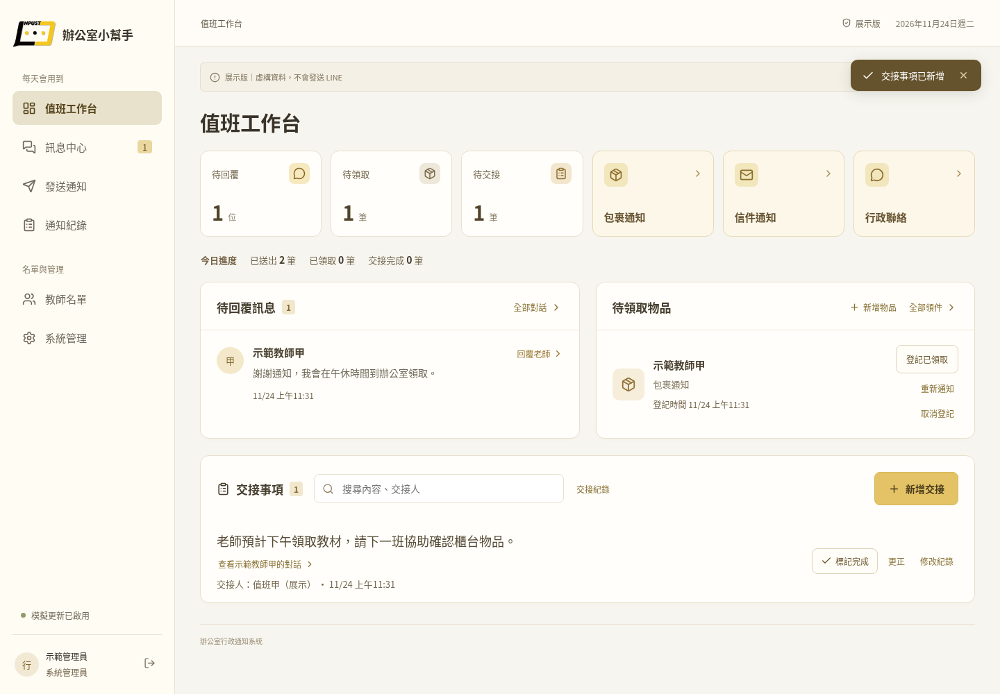
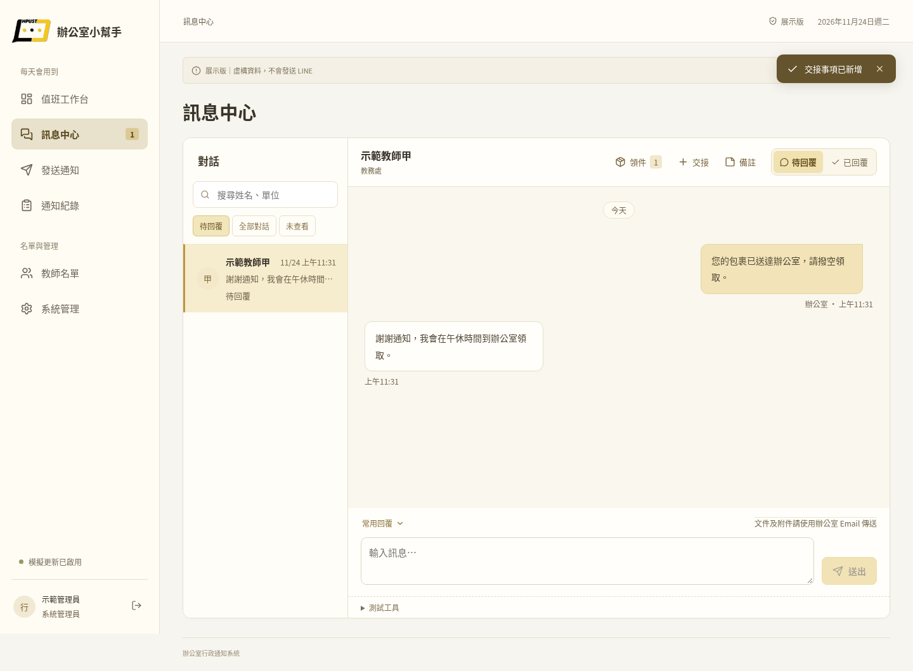
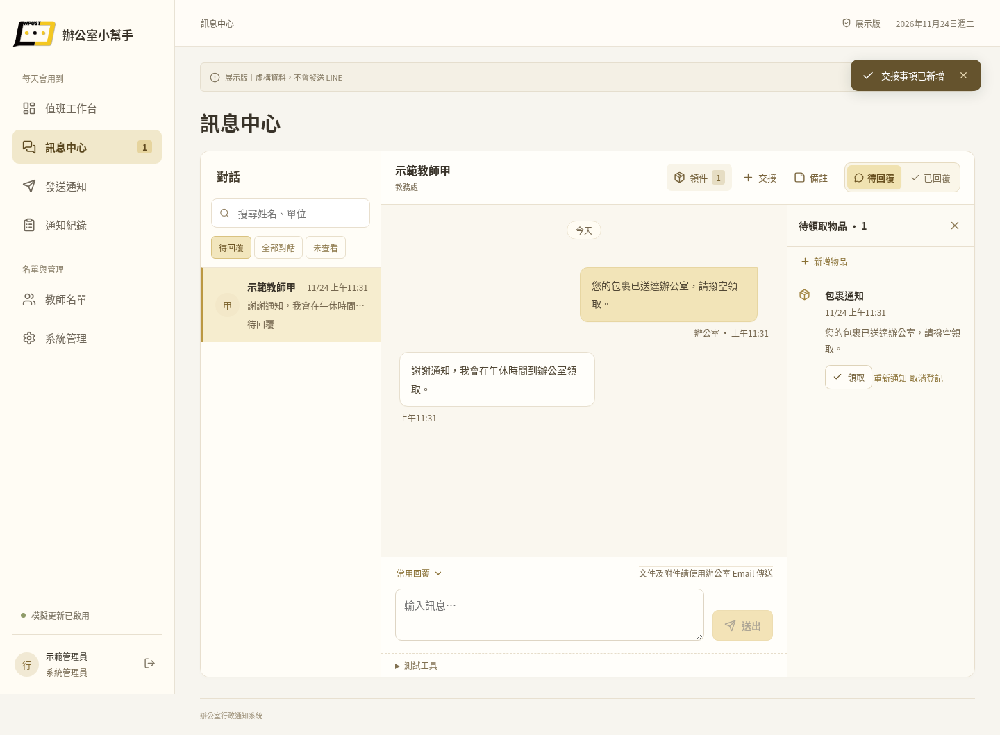
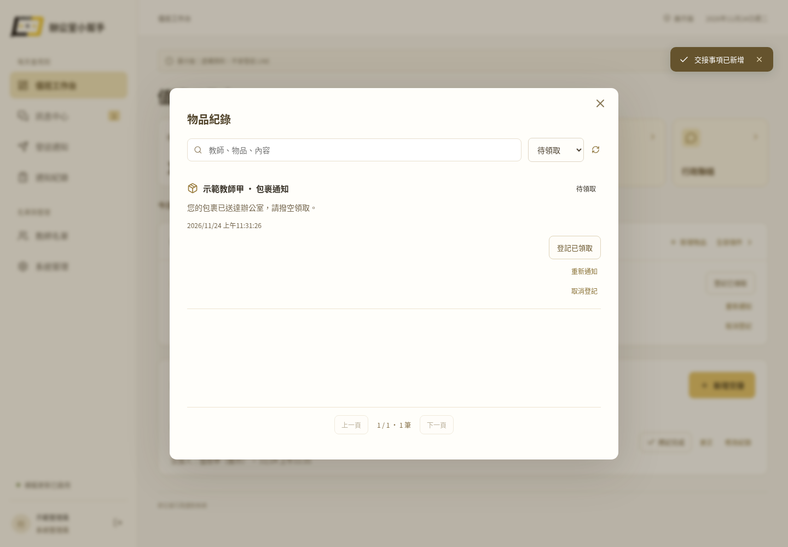
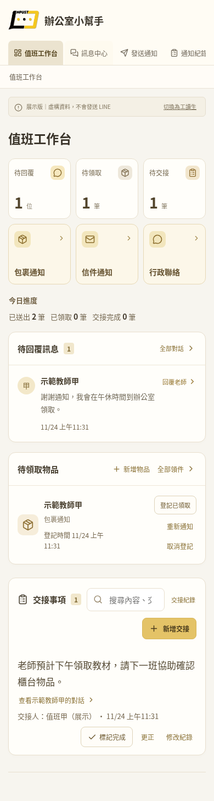
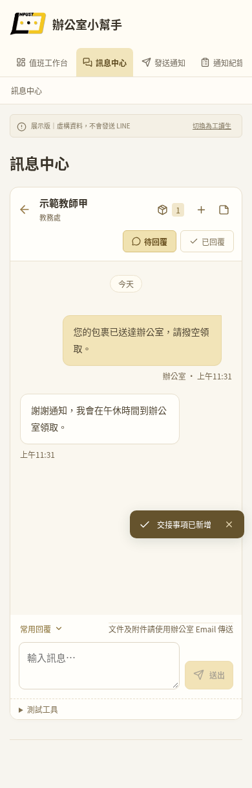

# 辦公室小幫手：操作流程更新 2026.11.24.1

這是更新檔案下載分支，正式專案為 [npust-lc/office-line-notifier](https://github.com/npust-lc/office-line-notifier)。尚未合併或部署至正式站。

## 先看預覽

[下載 HTML 預覽 ZIP](https://github.com/ching-yu430/office-line-notifier/raw/refs/heads/office-workflows-update-download/office-line-notifier-html-preview.zip)，解壓縮後用 Chrome 開啟 `office-line-notifier-preview.html`。只有虛構資料，不會傳送 LINE；檔案無需上傳 GitHub。也可[直接下載 HTML](https://github.com/ching-yu430/office-line-notifier/raw/refs/heads/office-workflows-update-download/office-line-notifier-preview.html)。

可試：未綁定教師僅登記物品、重新通知、領取、取消、回覆、從對話建立交接、工讀生查已完成交接、更正與歷史紀錄。預覽保留原始透明黑黃 Logo、暖黃配色，不需要輸入正式帳密。

## 更新檔案

- [下載累積整合更新包](https://github.com/ching-yu430/office-line-notifier/raw/refs/heads/office-workflows-update-download/office-line-notifier-combined-update.zip)：86 個檔案，包含先前尚未上傳的修正與本次流程；建議使用這包。
- [只下載本次流程更新](https://github.com/ching-yu430/office-line-notifier/raw/refs/heads/office-workflows-update-download/office-line-notifier-workflow-update.zip)：44 個檔案，供已完成 2026.11.19.2 的專案。
- [Git patch](https://github.com/ching-yu430/office-line-notifier/raw/refs/heads/office-workflows-update-download/office-workflows-update.patch)：本次原始碼 commit，供 `git am` 合併；同樣需先規劃 D1 Migration 與部署順序。

不要把這個下載分支的 Code ZIP 整包當作正式設定覆蓋。應使用上方專用更新包，依原路徑覆蓋檔案。更新包未包含 `.env`、`.dev.vars`、Wrangler 設定與環境範本，不會重設您已有的 Database ID、Origin 或 Secrets。Preview、PNG、ZIP、patch、manifest 與本頁都不需要上傳正式應用程式。

## 正式更新順序

1. 先試用 HTML；確認後才處理正式服務。
2. 專案資料夾放入更新檔案，在本機執行 `npm.cmd ci`、`npm.cmd test`、`npm.cmd run build:cloudflare`。
3. 暫停同仁操作並匯出完整 D1 SQL 備份；內容 ZIP 不能取代可還原的完整 SQL 備份。
4. 執行 `npx.cmd wrangler d1 migrations list office-line-notifier --remote`，確認未套用清單，再執行 `npx.cmd wrangler d1 migrations apply office-line-notifier --remote`。本次需要 **0006_office_workflows.sql**；舊版 0003–0005 尚未套用者也會依序套用。
5. Migration 完成後，才提交 GitHub、讓 Pages 重新部署。若有自動部署，請勿在 Migration 前先推送前後端程式。

完整 PowerShell 指令與注意事項見 [操作流程更新](docs/OFFICE-WORKFLOWS-UPDATE.md)。原始碼 commit `5c1424b`；123 項單元／D1 整合驗證通過，62 項完整瀏覽器案例通過，最終改動後另重跑 16 項通過。LINE 對外 HTTP 使用 Mock，本次未發送真實訊息。

## 畫面

