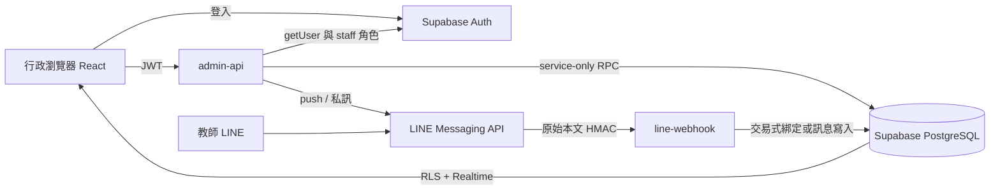

# 架構與開發計畫

## 可執行的開發順序

1. 環境盤點，建立獨立 React + Vite 專案，無個資的 mock 資料與六頁操作骨架。
2. 第一階段：Migration、教師、私有綁定與碼、角色與 RLS、簽章驗證、交易式綁定、稽核；先以 SQL／密碼學測試驗證。
3. 第二階段：範本與通知資料、去重請求、逐筆 Messaging API push、預覽確認、結果顯示。
4. 第三階段：接收訊息、事件去重、收回 tombstone、Realtime 訂閱、網頁文字回覆、對話待回覆與完成。
5. 第四階段：Auth 多人角色、篩選、完成經辦、設定頁、桌機／手機測試、操作文件。所有真實部署與教師通知保留待使用者核准。

本次 1–5 已完成程式及本機驗證；正式雲端整合尚待憑證與測試環境。

## 資料流

前端只有專案 URL／publishable key。LINE Secrets 與 Supabase Service Role Key 僅在 Functions。LINE User ID、碼雜湊、猜測桶與 Webhook 去重表在不暴露的 private schema；不透過前端或 Realtime 傳送。

## 資料表

| 表 | 目的 | 前端權限 |
| --- | --- | --- |
| public.staff | Auth UID、顯示名稱、管理員／行政、停用 | 讀自己，管理員可讀全員 |
| public.teachers | 姓名、單位、備註、停用、綁定與最後通知時間 | 有效行政唯讀 |
| public.notifications | 收件教師、類型、內容、sender、request、retry UUID、綁定版本、發送／業務狀態、完成時間／經辦 | 有效行政唯讀 |
| public.messages | 內／外文字、教師、通知關聯、LINE message ID、收回旗標 | 有效行政唯讀 |
| public.conversations | 每教師對話處理狀態、最新收到時間、完成經辦 | 有效行政唯讀 |
| public.templates | 四種通知範本 | 有效行政唯讀 |
| public.audit_logs | 操作者、事件、教師、時間；不含碼、Token、訊息正文 | 僅管理員可讀 |
| private.bindings | teacher PK、LINE user UNIQUE、binding UUID、封鎖狀態 | 無 |
| private.binding_codes | teacher PK、HMAC UNIQUE、七天到期、產生人 | 無 |
| private.events | webhookEventId PK、處理時間／結果，不保存原始 body | 無 |
| private.message_sources | 私有來源對照，授權收回原訊息，即使教師已解除綁定 | 無 |
| private.unsent_messages | 收回事件 tombstone，處理逆序事件 | 無 |
| private.rate_limits | 每 LINE user／全局每小時嘗試次數 | 無 |

所有表啟用 RLS；前端不能 INSERT／UPDATE／DELETE。僅公開 `office_role()` 受限的 SECURITY DEFINER 成員查詢，固定空 search_path、只讀當前 auth.uid、PUBLIC／anon 不可執行。其他 RPC 使用 SECURITY INVOKER，撤銷 PUBLIC／anon／authenticated 的 EXECUTE，只允許 service_role。service_role 拿到的權限很高，Functions 必須先驗證身分再轉入 SQL；禁止客戶端直接呼叫任意 actor RPC。

### 綁定交易

- Web Crypto CSPRNG 產生 12 個無混淆字元，字母表 32 字元，60 bits 熵；不是姓名／學號的編碼。
- 以後端 Pepper 作 HMAC-SHA256，資料庫只存 digest，明碼僅回傳管理員一次且不記錄日誌。傳送採 HTTPS。重發碼取代舊碼。
- `line_event` 以 webhookEventId 去重，持有交易 advisory lock，查七天有效碼，鎖定教師、確認 active、插入唯一綁定、更新時間、刪碼與寫稽核一併提交。
- LINE User ID UNIQUE、teacher PK 保護併發；解除／發碼也使用相同 advisory lock。已綁定 LINE 輸入其他碼會當一般文字，不會任意換綁。
- 每 LINE 帳號每小時最多 10 次未綁定訊息嘗試；全系統每小時最多 1000 次。無效碼／過期碼同樣回覆，避免公開探測教師狀態。
- 成功提交後才用一次性 replyToken 回覆；回覆 LINE 失敗不會撤回已成功的身分綁定，也不再次消耗碼。事件標記 reply_failed 供後台維護核對。管理員可查看 bound_at；教師再傳文字會進入對話。

### 發送交易與可靠性

- 後端雙重驗權，建立通知前全批確認 active、唯一綁定且未封鎖；任何一人不可發送則整批 rollback。
- `request_id + teacher_id` UNIQUE 保護同一次確認重複請求；相同 request 不接受不同內容／寄件人。新的確認視窗會產生新的 request，因此行政人員仍需避免重建相同通知。
- `claim_delivery` 使用 row lock，一次只能領取 queued；記錄綁定版本，領取前比對可避免解除／換綁後寄到舊帳號。傳送中或結果未明時，禁止教師編輯／停用／解除，以免變更身分時外部推播仍在途中。
- 每筆有固定 `X-Line-Retry-Key`，避免同一 API 請求在 LINE 端重複接受。只在 2xx 或有 accepted-request-id 的 409 視為 API 接受；不代表送達／已讀。
- 4xx 記為 failed；5xx、timeout、網路異常為 uncertain。Functions 中途消失可能留下 sending；維護者核對，不自動重送。
- 一次立即執行最多 5 筆，其餘 queued 可由紀錄處理；正式大量作業應改用 durable queue。資料庫先保存通知，不因 LINE 出錯遺失紀錄。

### 收回、附件與 Realtime

訊息 ID UNIQUE 與事件 ID PK 雙重去重。收回正文替換為提示文字；逆序收回透過私有 tombstone 防止原文重新出現。對話事件若時間早於當前綁定會略過，避免換綁後舊事件落入新的教師；收回以原訊息來源比對，即使解除綁定仍能正確撤回舊正文。非文字訊息僅存提示，未下載附件；未來可增加 message_type、media reference 與私有 Storage，必須另設保留期限與讀取政策。

Realtime 僅發布 safe tables，前端依 RLS 讀取並重新載入最新資料；失去連線會顯示提示。最新資料取回限制與分頁待辦明列 README。解除／授權角色變動後，後端即時查表拒絕停用使用者；已呈現的頁面／已下載資料仍需辦公室端裝置管理。

## 交接事項更新

新增 public.handovers，與 teachers／notifications 無強制關聯，保存獨立的交接內容、建立時間／人員姓名快照、完成時間／經辦姓名快照。audit_logs 增加 handover_id 外鍵。authenticated 僅獲 RLS 保護的 SELECT，匿名與未授權使用者不可見；寫入透過 admin-api 認證與 handover_command 再次驗權（SECURITY INVOKER，EXECUTE 僅 service_role）。

建立請求以指定 UUID 去重，完成交易鎖定資料列，已完成者不再改寫經辦。不同當班人員可接手，不會呼叫 LINE API、也不新增訊息。前端訂閱 handovers Realtime。舊通知的 important 歷史欄位保留，展示介面已改用交接事項。
