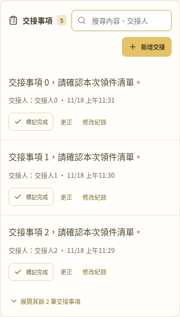
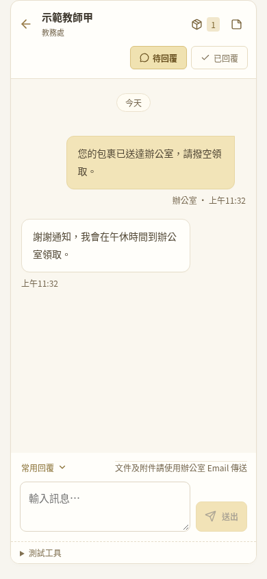

# 辦公室小幫手：2026.11.18.2

本包整合先前尚未上傳的兩批修改，沿用原始透明黑黃 Logo 與暖黃色設計。全部畫面使用虛構資料，沒有更新正式網站、遠端 D1 或發送真實 LINE。

[下載可操作的 HTML 預覽包](office-line-notifier-html-preview.zip) · [下載整合更新包](office-line-notifier-combined-update.zip) · [完整更新說明](docs/CONVERSATION-UPDATE.md) · [測試結果](docs/TEST-REPORT.md)

## 先看預覽

HTML 預覽包解壓後，直接用 Windows Chrome 開啟 **office-line-notifier-preview.html**。不需要安裝 Node、上傳或登入，可操作各分頁、通知、領件、交接及模擬 LINE 回覆。這些操作只使用虛構資料，不會同步正式網站。

請勿把預覽 HTML 覆寫為正式網站的 index.html。圖片、程式與樣式皆已內嵌；自動化以同一份 HTML 載入測試，沒有額外 HTTP／API 請求。開發環境的受管理瀏覽器限制 file://，Windows Chrome 直接開檔仍須試開驗收。

## 工作台與交接

「新增物品」靠在「全部領件」左側；交接搜尋位於「交接事項」右側，手機亦維持標題與搜尋同列。

## 訊息中心

「待回覆／已回覆」直接點按切換，暖黃色表示目前狀態。成功回覆後自動已回覆；教師新訊息進來自動待回覆，不需額外勾選。領件與備註維持按需開啟。

## 其他待領物品

其他待領物品統一使用多箱物品圖示，預覽、工作台、聊天領件及多筆領取顯示一致；原有信件及包裹圖示保留。

## 已合併的前版功能

個人綁定 QR／連結、交接大字搜尋與收合、多筆領取及復原、重複通知提醒、查詢位置保留、自填待領物品、精簡聊天及輕量輪詢都已包含。

訊息中心操作時約每 3 秒檢查，其他頁約 10 秒，閒置兩分鐘後 30 秒，背景暫停；無變更時不重載對話。免費方案用量限制見更新說明。

77 項單元／整合、42 項瀏覽器測試及正式模式建置通過。LINE HTTP 為 Mock，新增流程未用真實 LINE 驗收。

## 之後才上傳

現在可先看 HTML，不用更新正式網站。準備好時合併更新包中的 **src、worker、tests、docs、migrations、scripts 六個資料夾**及根目錄 **package.json、package-lock.json**，覆寫同名檔案並保留其他舊檔。不要上傳 ZIP 或預覽 HTML。

若尚未套用，先備份並套用 **0003_pickup_items.sql**；再確認上傳 GitHub main 觸發正式部署。保留原 D1、帳號、綁定、wrangler.jsonc、環境檔與 Secrets；更新包不包含設定檔。

整合包 SHA256：`402455ad3bd9dbcb2225128f319ae3450281739e1345debc49a5a8312628eccd`

HTML 預覽包 SHA256：`f6364bf3d42de46c81ae576028549be35cc05f1beed64ca96dc8d9e99cdcd914`
