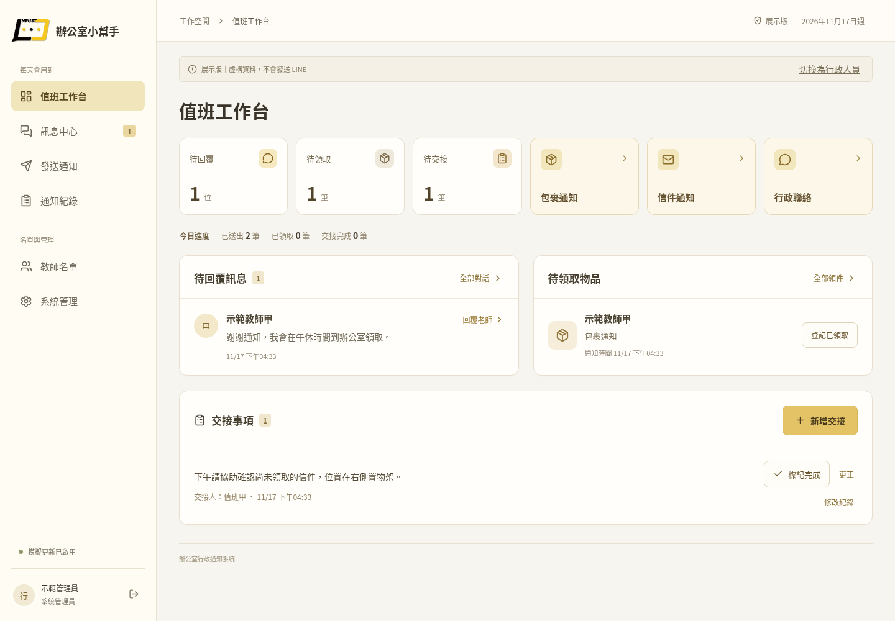
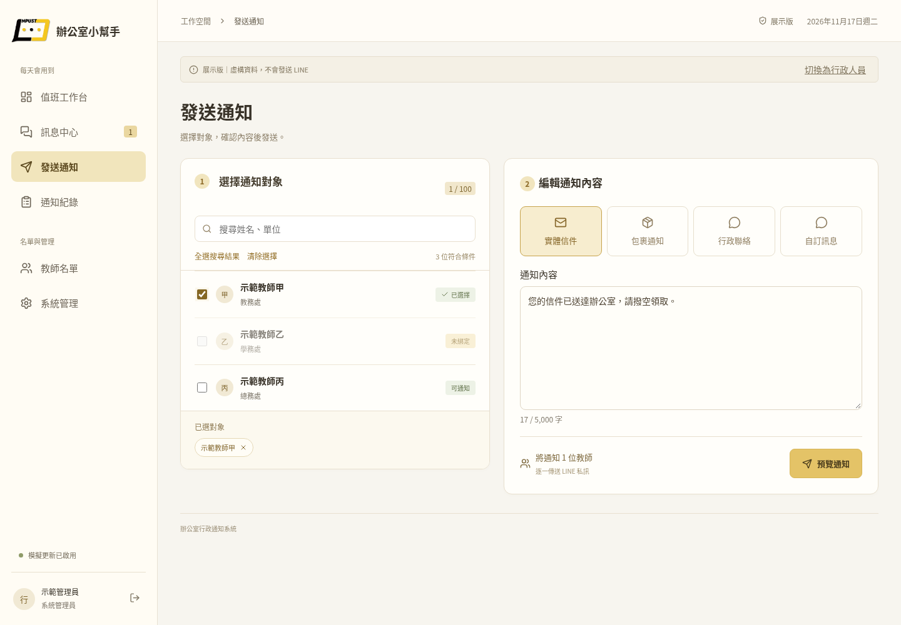
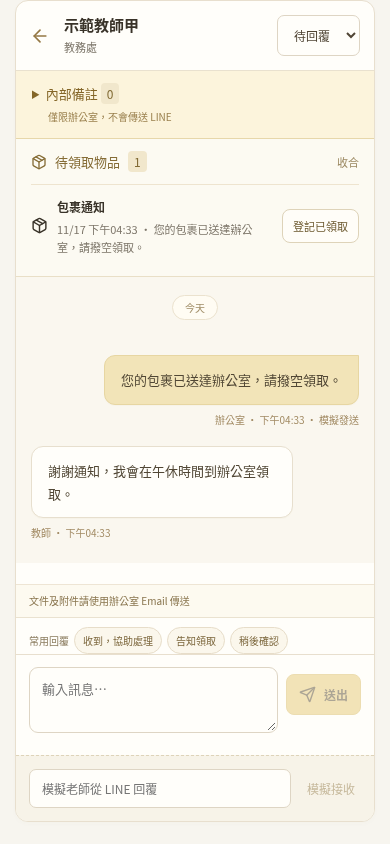
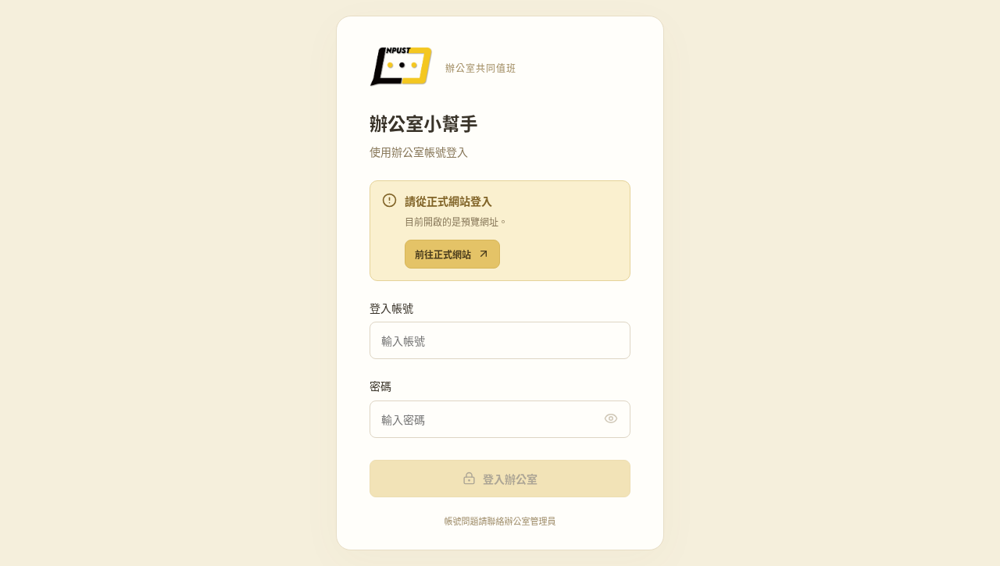

# 辦公室小幫手：2026.11.17.2 預覽

以下使用虛構示範資料，正式網站尚未更新。保留原始透明 Logo 與暖黃色風格。

[下載更新包](office-line-notifier-refinement-update.zip) · [完整更新與本機操作說明](docs/REFINEMENT-UPDATE.md)

更新包解壓後只有 `src`、`worker`、`tests`、`docs` 四個資料夾中的變更檔案；此次不需要再執行資料庫遷移。

驗證：59 項單元／整合測試、27 項瀏覽器測試與正式版建置通過；LINE HTTP 為 Mock，沒有對真實教師發送。

## 值班工作台

六張卡片維持同排，今日進度與待辦更緊湊。

## 批次通知

只全選搜尋結果，明確核對已選教師。

## 訊息中心

多行回覆、日期分隔，配合視窗高度保留回覆區。

## 通知紀錄

正式版查詢全部歷史，每頁 10 筆、日期與教師條件可組合。

## 手機對話

直接進入對話，可返回名單；不必先滑過教師列表。

## 預覽登入指引

誤開預覽網址時，提供正式入口；沒有放寬登入驗證。

更新包 SHA256：`0f435825de22c4836a5abfd047a9f5b778539db1d7ea8049c93fc8e82b7e35eb`
