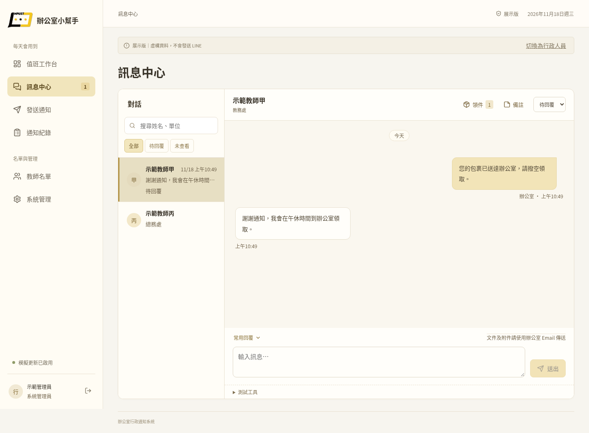
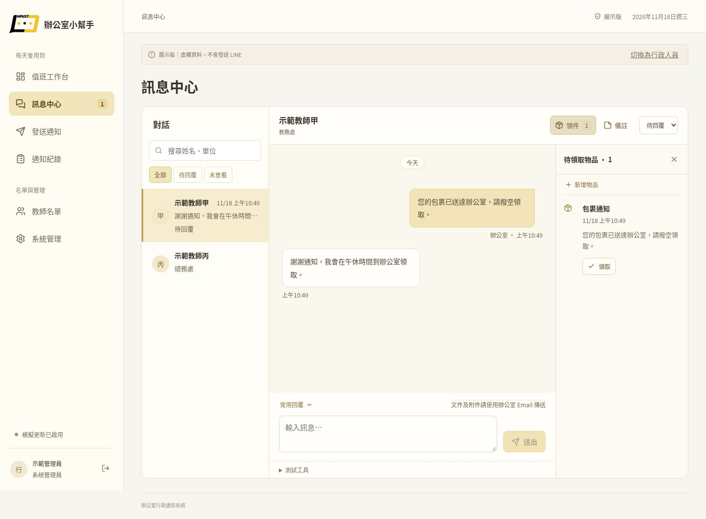
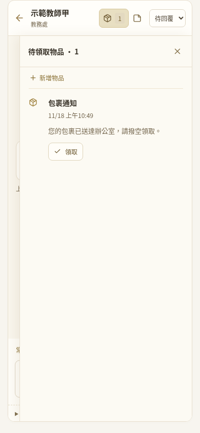
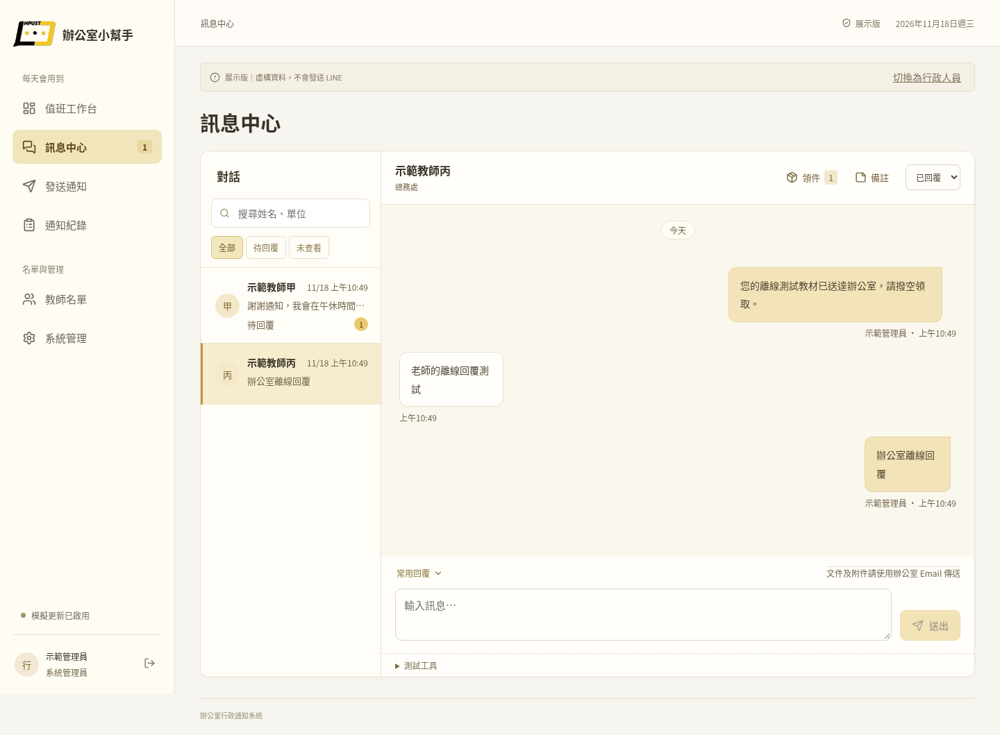
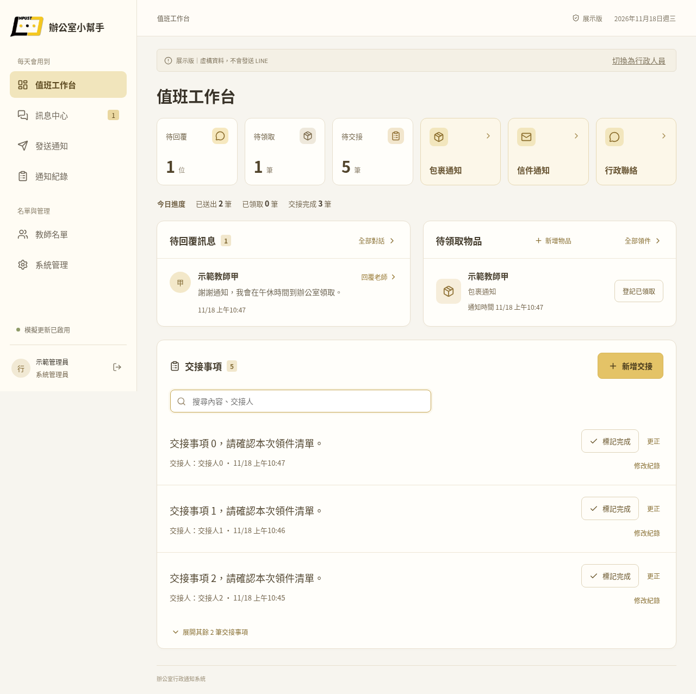

# 辦公室小幫手：2026.11.18.1

此版整合上一批未上傳的修改，沿用原始透明黑黃 Logo 與暖黃色配色。以下全為虛構資料；正式網站、D1、LINE Secrets 尚未變更。

[下載可操作的 HTML 預覽包](office-line-notifier-html-preview.zip) · [下載兩批整合更新包](office-line-notifier-combined-update.zip) · [完整更新與 Windows 說明](docs/CONVERSATION-UPDATE.md) · [測試結果](docs/TEST-REPORT.md)

## 先試用 HTML

HTML 預覽包解壓後只有 **`office-line-notifier-preview.html`**，直接用 Windows Chrome 開啟，不需要上傳、Node、登入或 Cloudflare。可操作各分頁、通知、領件、交接、模擬回覆；所有資料都是虛構，不會發送 LINE。想改版面或流程時，再提供修改清單或截圖即可。

這是建置後的預覽；不要把它當作正式網站入口覆寫 `index.html`。[單一 HTML 原檔](office-line-notifier-preview.html) 可另存，但建議下載上方 ZIP 後開啟。

HTML 的圖片、樣式及程式已內嵌。自動化以相同 HTML 攔截為測試文件載入，確認操作正常且無額外 HTTP／API 請求；開發環境瀏覽器限制 file://，Windows Chrome 直接開檔仍需你試開。

## 訊息中心

預設只保留對話與回覆框；領件／備註按需開啟，常用回覆折疊。

## 自填待領物品

名稱會顯示在預覽、工作台、領件、多筆處理與歷史，手動訊息不被物品名稱變更覆蓋。

## 手機操作

## HTML 實際操作畫面

下圖使用單一 HTML 測試自填物品與模擬回覆。

## 上一批內容也已合併

個人綁定 QR／連結、交接大字搜尋與收合、多筆領件、重複通知確認、查詢位置保留。

## 更新速度與測試

操作訊息中心約每 3 秒做輕量版本檢查；其他頁約 10 秒、閒置兩分鐘後 30 秒、背景暫停、連線失敗退避。無變更時不重新載入整份資料與對話。免費方案仍有總請求／CPU／D1 限額，細節與估算見更新說明。

77 項單元／整合與 41 項瀏覽器測試通過，正式模式建置通過。LINE HTTP 為 Mock，新 QR 與新通知流程尚未完成真實手機驗收。

## 之後上線時

你現在不用上傳。準備好時，只使用本整合更新包，合併 **`src`、`worker`、`tests`、`docs`、`migrations`、`scripts` 六個資料夾**及根目錄 **`package.json`、`package-lock.json`**；保留舊檔，勿刪 0001／0002。先備份並套用新增 **0003**，再確認上傳 GitHub `main` 觸發正式部署。不重設 D1、帳號、綁定或 Secrets；設定檔不在更新包內。

整合包 SHA256：`19a4c5978c66d5c6bedb979636372d3ac633bd2a656b094cd54f95c5ab326a3d`

HTML 預覽包 SHA256：`b0b396931b57cd088664c524a9a9c05dad5178bbcabad81bdad313c3b37c98fd`
