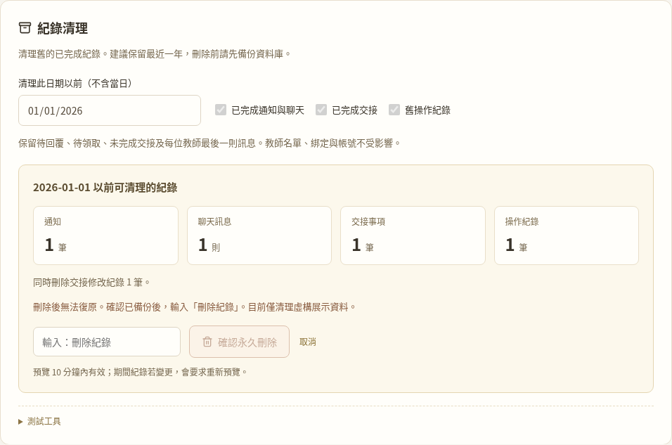
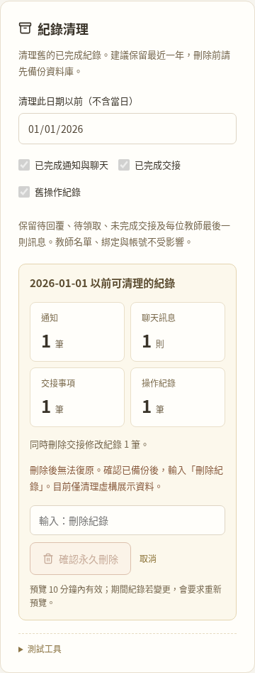
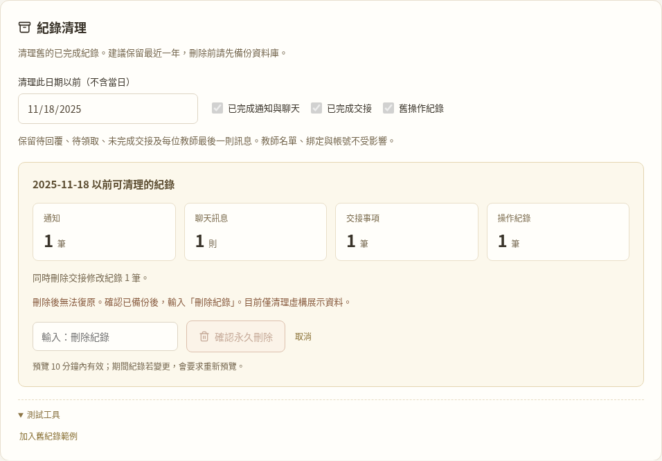
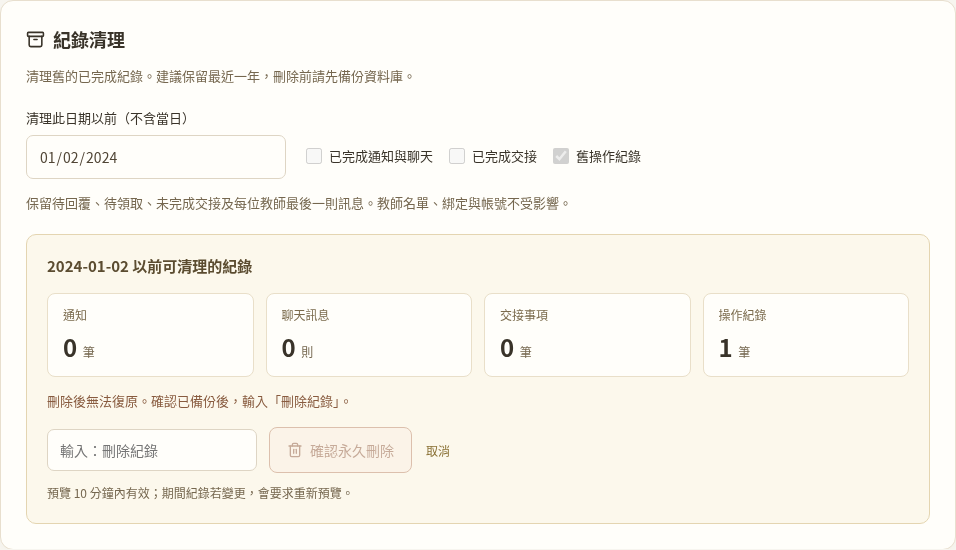
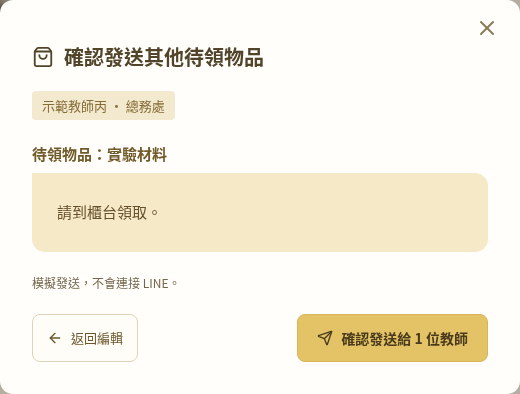

# 辦公室小幫手：2026.11.18.4

本包整合先前尚未上傳的修改，維持原始透明黑黃 Logo 與暖黃色設計。沒有更新正式網站、修改遠端 D1、刪除真實紀錄或發送真實 LINE。

[下載 HTML 預覽包](office-line-notifier-html-preview.zip) · [下載整合更新包](office-line-notifier-combined-update.zip) · [更新與 Windows 指令](docs/CONVERSATION-UPDATE.md) · [紀錄清理說明](docs/RECORD-CLEANUP.md) · [測試結果](docs/TEST-REPORT.md)

## 不用上傳就能試用

HTML 預覽包解壓後，用 Windows Chrome 開啟 **office-line-notifier-preview.html**。可操作各頁面、通知、聊天、交接與領件，沒有正式 API 請求，也不會發送 LINE。圖片、樣式及程式皆已內嵌。

試用這次功能：進入 **系統管理 → 紀錄清理 → 測試工具 → 加入舊紀錄範例**，再按「預覽可清理紀錄」，便可用虛構舊資料測試取消及確認刪除。正式模式沒有此測試工具。

請勿把這份 HTML 覆寫成正式網站的 index.html。開發環境的受管理瀏覽器限制 file://，自動化以相同成品載入驗證；Windows Chrome 直接開檔仍須試開驗收。

## 管理員紀錄清理

系統管理底部新增清理卡片。預設保留最近一年，日期與範圍可調整；先看通知、聊天、交接與操作紀錄筆數，確認備份後輸入「刪除紀錄」才可執行。

待回覆、待領取、未完成交接、每位教師最後一則訊息、教師名單與綁定均保留；歷次清理摘要保留人員、時間及筆數。刪除不可快速復原，相關資料變更時要求重新預覽。每批有筆數上限，完成後可再次預覽。

SQLite／D1 清理後能重用空間，配置容量不一定立即變小。Webhook 與發送請求的精簡防重複識別仍保留，避免舊事件或瀏覽器重試造成重新通知。

## 之前的修改也已包含

提袋圖示、交接操作同列、交接搜尋在標題右側、新增物品靠近全部領件、直接點按對話狀態、自填物品、精簡聊天、三秒輕量更新、QR 綁定及多筆領件都在同一包內。

## 測試與正式更新

86 項單元／整合、47 項瀏覽器測試及正式模式建置通過。測試僅使用虛構資料及 LINE HTTP Mock，不代表本次已執行真實 LINE 驗收或正式清理。

準備更新時，合併 **src、worker、tests、docs、migrations、scripts 六個資料夾**及根目錄 **package.json、package-lock.json**，覆寫同名檔案並保留其餘舊檔。不要上傳 ZIP 或預覽 HTML；原有 wrangler.jsonc、環境檔、D1 ID 與 Secrets 保留。

**先備份 D1，套用尚未執行的 0003 及新增 0004_record_cleanup.sql，再確認上傳 GitHub main 觸發部署。** 若已套用 0003，這次只需 0004。Migration 只升級結構，不會自動刪除歷史。

整合包 SHA256：`3185447ee85441854125697f1d0464d0dedb2f8cb25333cd7d755d3593cac3e7`

HTML 預覽包 SHA256：`f23b9392421ecc9e68a5758bf551c8d665cbe0d597be61325bf110082de1b867`
