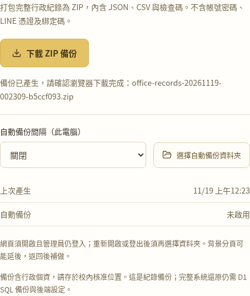
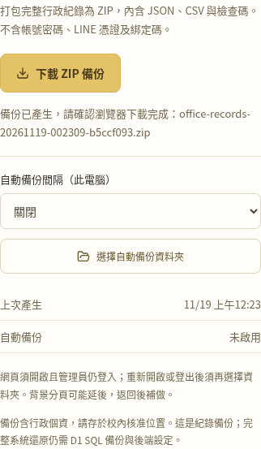
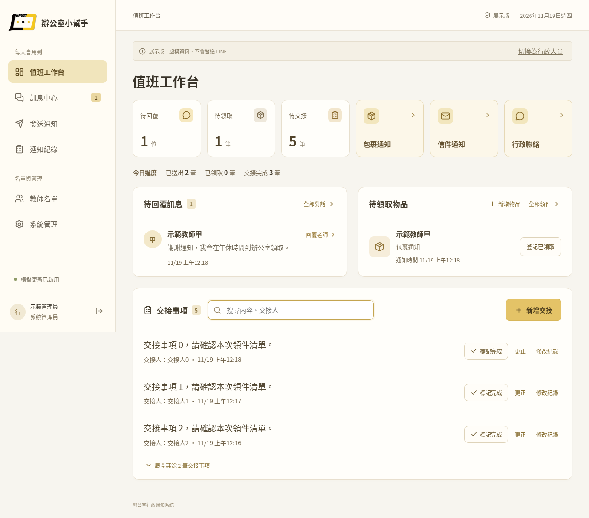

# 辦公室小幫手：2026.11.18.5

本包整合先前尚未上傳的修改。原始透明黑黃 Logo、暖黃色風格、教師綁定、文字通知、訊息中心、交接與領件功能均保留。沒有公開部署、修改遠端 D1、清理真實資料或發送真實 LINE。

[下載 HTML 預覽包](office-line-notifier-html-preview.zip) · [下載整合更新包](office-line-notifier-combined-update.zip) · [更新與 Windows 指令](docs/CONVERSATION-UPDATE.md) · [紀錄備份說明](docs/RECORD-BACKUP.md) · [安全檢查報告](docs/SECURITY-REVIEW-2026-11-18.md) · [測試結果](docs/TEST-REPORT.md)

## 先開 HTML 試用

解壓 HTML 預覽包，用 Windows Chrome 開啟 **office-line-notifier-preview.html**。所有資料皆為虛構，不會連接正式 API 或發送 LINE。可直接到 **系統管理 → 紀錄備份 → 下載 ZIP 備份**，實際產生一份虛構行政紀錄 ZIP。

圖片、樣式及程式均已內嵌，不必安裝 Node 或先上傳。不要把這份預覽 HTML 覆寫為正式網站的 index.html。開發環境的受管理瀏覽器限制 file://，自動化使用同一份成品載入測試；Windows Chrome 直接開檔與原生資料夾授權仍須你試用驗收。

## 系統管理重新收整

上方狀態與帳號維持並排及等高，主要按鈕可見；維護資訊改為收合。通知範本、最近操作、最近交接、備份及清理按需展開，仍保留日期篩選、每頁五筆及固定高度捲動，收合狀態在本次登入保留。

## 網頁直接下載紀錄 ZIP

管理員可下載完整行政紀錄，不受畫面最近 500 筆限制。ZIP 內含原文 JSON、安全 CSV、筆數與 SHA-256 檢查碼；資料變更或筆數不完整時不會提供部分備份。排除帳密、Session、LINE 憑證、LINE User ID 與綁定碼；這是行政紀錄備份，完整系統復原仍需 D1 SQL 備份及後端 Secrets。

可選擇電腦資料夾，設定每 **1／7／30 天**自動備份，預設關閉。需要網頁開啟、管理員仍登入及瀏覽器授權；背景分頁回前景後補做。**關閉網頁後不執行，重新開啟需再選擇資料夾。** 不新增 R2 或付費服務，檔案不存回 D1，也不產生公開個資下載連結。

## 安全與穩定性

已修正成功登入誤累計限制、不同帳號限制桶衝突、舊 401 誤登出新帳號、同時訊息順序、清理舊快照及管理欄位驗證。備份另有後端管理員／來源／CSRF／HMAC／版本驗證、CSV 公式防護、登出取消與多視窗保護。

正式執行依賴 `npm audit --omit=dev` 為 **0**。開發工具仍有 **1 項 picomatch 根源公告、5 個 high 相依節點**尚待上游發布修補，沒有標示為全部修復；它們不在正式 Pages／Workers 執行程式中，開發及預覽預設限本機。詳見安全檢查報告。

100 項單元／整合、54 項完整瀏覽器、最後版面再跑 8 項相關測試及正式模式建置通過；全為虛構資料與 LINE HTTP Mock。資料夾自動化使用 API 替身，不代表已完成 Windows 多日實機驗收。

## 累積功能也已包含

個人綁定 QR、交接搜尋及大字收合、多筆領取與復原、重複通知提醒、提袋圖示、自填待領物品、直接點按對話狀態、輕量三秒更新與紀錄清理均已合併。

## 之後正式更新

先看預覽，不必立即更新。準備好時合併 **src、worker、tests、docs、migrations、scripts 六個資料夾**，以及根目錄 **package.json、package-lock.json、vite.config.ts 三個檔案**；覆寫同名檔案並保留其他舊檔。不要上傳 ZIP 或預覽 HTML；原 wrangler.jsonc、環境檔、D1 ID、帳號與 Secrets 保留。

**先備份 D1，再依序套用尚未執行的 0003、0004 及新增 0005_record_exports.sql**，確認後才上傳 GitHub main 觸發正式部署。Migration 只升級結構，不會自動備份或刪除既有資料。不需新增 Secrets。

整合包 SHA256：`24eac63ea078ede11f495b9a6a025d283f7b5ff69e62e173cb6e34df4628d6e2`

HTML 預覽包 SHA256：`fcf289f02dec870207a6ea18f64c269914f0370ba95d80ad72ce073f57bcccdc`
