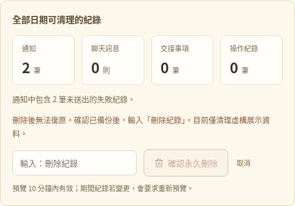

# 辦公室小幫手：失敗通知清理修正 2026.11.19.2

已在本機重現歷史 401 無法清理及處理完成仍提醒的問題。已上傳 2026.11.19.1 者，只需本次四資料夾修正包，不必重做資料庫升級。

[下載本次修正包](office-line-notifier-failed-cleanup-fix.zip) · [下載 HTML 預覽包](office-line-notifier-html-preview.zip) · [更新與清理步驟](docs/FAILED-NOTICE-CLEANUP-FIX.md) · [測試結果](docs/TEST-REPORT.md)

## 已修正

- 首頁與通知紀錄的「需要檢查」排除已處理項目，原始失敗原因仍保留。
- 清理新增「全部日期（含今日）」與獨立的「發送失敗通知」，可以預覽後刪除原 401 紀錄。
- 空結果會提示日期與失敗類別的差別；失敗的包裹完成處理顯示已處理，避免誤顯示已領取。
- 三個系統管理分類、原始透明黑黃 Logo 與暖黃色版面保留。

## 先試用 HTML

解壓 HTML 預覽包，用 Windows Chrome 開啟 **office-line-notifier-preview.html**。在系統管理 → 資料維護 → 紀錄清理 → 測試工具，按 **加入失敗通知範例**。返回首頁可看到兩筆虛構 401 提醒。

接著回到紀錄清理，選 **全部日期（含今日）**，只勾 **發送失敗通知**，按預覽。應顯示通知 2 筆，其餘 0 筆；確認文字尚未輸入時，永久刪除按鈕會保持停用。

輸入「刪除紀錄」並確認後，首頁提醒同步消失。

[手機預覽](preview-failed-mobile.png) · [完整資料維護畫面](preview-failed-maintenance.png) · [本機正式模式清理畫面](preview-cloudflare-failed-cleanup.png)

全部是虛構資料，不會連接正式 API、刪除正式紀錄或發送 LINE。受管理瀏覽器限制 file://，自動化使用相同成品攔截載入；Windows Chrome 直接開檔與原生資料夾權限仍須實機驗收。

## 如何更新剛上傳的版本

1. 解壓 **office-line-notifier-failed-cleanup-fix.zip**。
2. 合併包內 **src、worker、tests、docs 四個資料夾**至原完整專案，覆寫同名檔案並保留其餘舊檔。
3. 在完整專案執行 npm.cmd ci、npm.cmd test、npm.cmd run build:cloudflare。
4. 準備好正式更新時，從修正包解壓資料夾選四個資料夾，上傳至 npust-lc/office-line-notifier 的 main 根目錄。提交 main 會觸發既有 Pages 部署。
5. Pages 成功後，正式網站按 Ctrl＋Shift＋R，介面與後端版本應同為 **2026.11.19.2**。

本修正沒有新增 Migration、套件或 Secrets；已完成 0003／0004／0005 者不需要重跑 SQL。原 wrangler、環境檔、D1 ID、帳密與 LINE 憑證沿用。修正包共 **24 個檔案**，只含本次差異，不能當成空白專案啟動。不要上傳 ZIP、預覽 HTML、.dev.vars、備份或 node_modules。

如果前次仍未完整上傳，另有 [累積整合更新包](office-line-notifier-combined-update.zip)，共 **76 個檔案**，包含全部先前修改；依 [整合更新指引](docs/CONVERSATION-UPDATE.md) 合併六個資料夾與四個根目錄檔案。兩種更新包擇一使用。

## 正式清理兩筆紀錄

更新後，先在系統管理 → 資料維護 → 紀錄備份保存一份 ZIP。清理日期選全部日期，只勾發送失敗，核對預覽筆數後輸入刪除紀錄並確認。若筆數不符合預期，可取消預覽核對歷史。

已送出的未完成待辦、結果未明、傳送中、待發送、未完成交接、仍可快速復原的紀錄及每位教師最後一則聊天均保留。全部日期不表示可以清空所有資料；已完成通知若被保留的聊天引用也會保留。

刪除以預覽目標、版本及權限核對，在同一 D1 原子批次提交。狀態變更拒絕整批，SQL 錯誤回滾；已清理的發送請求保留精簡封存識別，舊頁面不能藉重試再次發送。清理不會重新呼叫 LINE，不會更新 Token。

## 驗證範圍

110 項單元／整合通過；57 項瀏覽器情境均已驗證（完整執行時一項新增假資料缺綁定欄位，修正後正式模式 9 項全數重跑通過）；正式模式建置及型別檢查通過。LINE HTTP 全為 Mock。沒有部署正式網站或操作正式資料庫。

依賴未改，沿用上次安全報告；開發工具 picomatch 公告仍待上游修補，沒有宣稱全部漏洞已排除。

修正包 SHA256：`d4ac894f3ad79ffe9ba2867cd469f8fee62f898f91b2d0c72568d53fe3b92fa6`

HTML 預覽包 SHA256：`b7d1182b6d1a25ab6090ad93686cb2a4f9a2eb370ad4dbee1c22794a5c253980`
