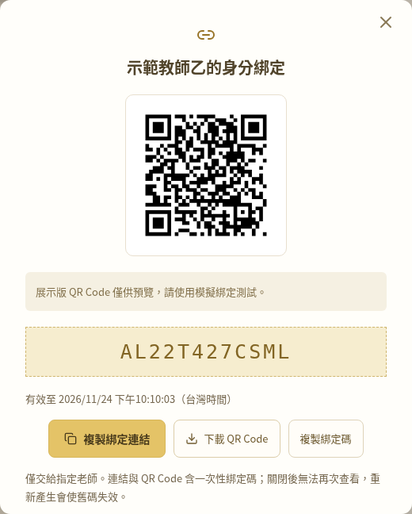
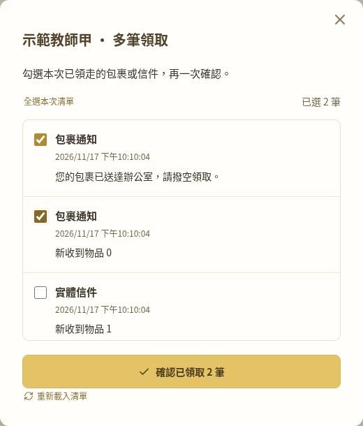
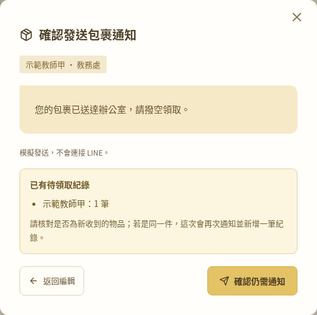
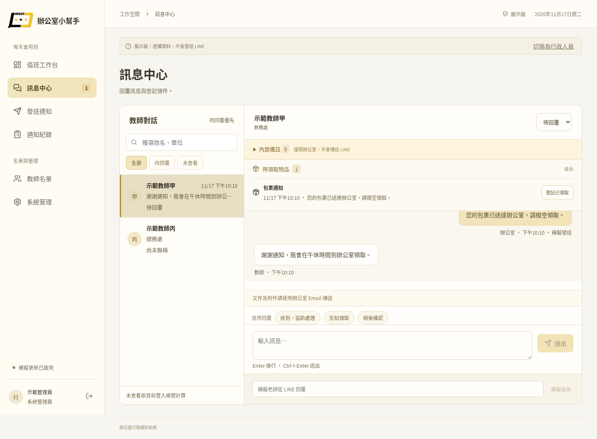
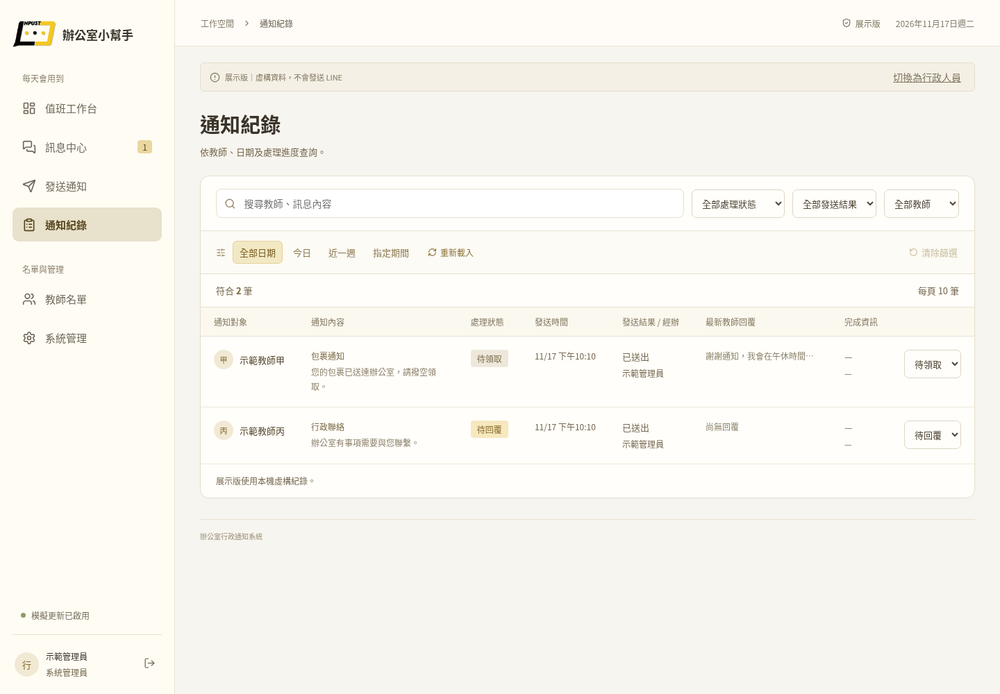
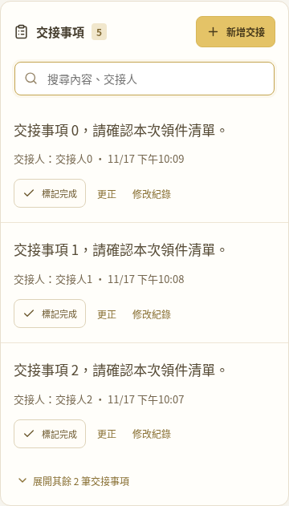

# 辦公室小幫手：2026.11.17.3 預覽

本版依驗證 A、1／2／4／6／7／8 與交接字體放大製作，延續暖黃色與原始透明 Logo。以下全是虛構資料，正式網站尚未更新。

[下載更新包](office-line-notifier-binding-desk-update.zip) · [更新、上傳與 Windows 操作說明](docs/BINDING-DESK-UPDATE.md) · [測試報告](docs/TEST-REPORT.md)

更新包是增量更新：合併 `src`、`worker`、`tests`、`docs` 四個資料夾，並覆寫根目錄的 `package.json`、`package-lock.json`。不要覆寫設定檔或重建資料庫。此次無須新 Migration，保留既有 D1、Secrets、帳號與教師綁定。確認要更新正式網站後，才將上述資料夾與兩個檔案上傳 GitHub `main`；該提交會觸發現有正式部署。

測試：67 項單元／整合、34 項完整瀏覽器測試通過；最後輔助文字調整另重跑 14 項通過，正式模式建置亦通過。LINE HTTP 與官方帳號資訊均為 Mock，尚未在真實手機驗證 QR／預填訊息。

## 交接事項

電腦 18px、手機 17px；預設三筆，可搜尋、展開與收合。

## 個人綁定

正式版使用官方帳號預填訊息連結，老師仍需按「傳送」。此圖為展示碼，無法連接學校 LINE。

## 多筆領取

勾選本次領走的物品，一次確認，保留其餘物品；可整批快速復原。

## 重複通知核對

已有待領取紀錄時，顯示教師與筆數，確認仍需通知後再送出。

## 訊息中心

輔助文字與時間提高可讀性；原本多人共用、回覆與輪詢保留。

## 通知紀錄

進入對話後可返回原搜尋、篩選、頁碼與捲動位置。

## 手機交接

更新包 SHA256：`b037554d9e43941c3e9c4c7d8c84e617269efda0424bb72ac35c34dc8c19c097`。
